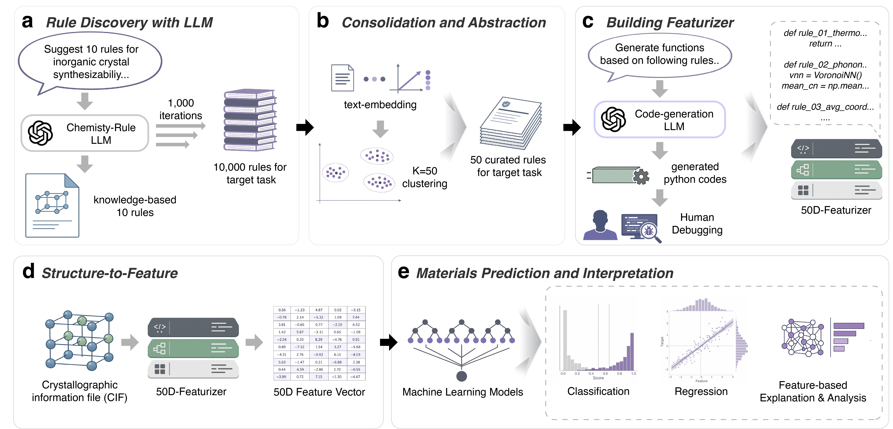

  
  <h1>CRISP</h1>
  
<strong>Compiling chemical knowledge into executable descriptors for materials prediction</strong>

  

    
    
    
    
  

CRISP is an LLM-assisted workflow for turning target-relevant chemical knowledge into compact, inspectable programs. The LLM explores and organizes chemical rules, then compiles each retained rule into a scalar descriptor. A conventional learner—not the LLM—consumes the resulting descriptor vector.

No task-specific LLM fine-tuning or large-corpus training is required: representation construction is performed through auditable API calls, and the resulting descriptor code can be inspected independently of the language model.

**Figure 1.** CRISP workflow for compiling chemical rules into executable crystal descriptors.

| Open | Use |
| --- | --- |
| [Rulebook.html](Rulebook.html) | Open the local file in a web browser to browse the rules and their Python functions. |
| [Predict.ipynb](Predict.ipynb) | Open a CIF and calculate a property or its descriptors. |
| [Generate_rules.ipynb](Generate_rules.ipynb) | Generate a new formation-energy catalog with the study prompts. |

Download and extract the code. Open a notebook in JupyterLab or VS Code with the Jupyter extension, select a Python 3.11 or 3.12 kernel, and choose **Run All**. The first cell installs any missing packages.

### Predict a property

**Original random forest model weights:** [Zenodo DOI: 10.5281/zenodo.24507254](https://doi.org/10.5281/zenodo.24507254).

To predict with these models, place **CRISP_RF_models.zip** beside **Predict.ipynb** without extracting it. To calculate descriptor values without the weights, select **Original CRISP · descriptors only** or **Qwen · descriptors only**. The rulebook and rule generation also work without the weights.

In **Predict.ipynb**, choose a property and click **Predict**. The examples are BaTe for synthesizability and formation energy, and an idealized cubic Li₃OCl structure for ionic conductivity. Use **Choose CIF** to open your own structure. The notebook displays the prediction and the value of each descriptor; **Descriptor values** opens a CSV.

| Original catalog | Output | Input |
| --- | --- | --- |
| Synthesizability · 50 rules | Positive–unlabeled random-forest score and decision threshold | CIF and its Materials Project ID and API key |
| Formation energy · 25 rules | eV per atom | CIF |
| Room-temperature ionic conductivity · 25 rules | S/cm and log₁₀ conductivity | CIF |

The BaTe example (Materials Project **mp-1000**) includes its six reference-dependent descriptor values and runs offline after installation. For another structure, the full synthesizability catalog looks up those inputs in the Materials Project. Formation energy and ionic conductivity run locally without credentials.

The synthesizability and formation-energy predictors use the seed-42 MP30 fits. The ionic-conductivity predictor was fitted on 503 solid electrolytes. The Qwen catalogs calculate 50 synthesizability or 25 formation-energy descriptors without calling an LLM. For a new CIF, Qwen synthesizability also uses its band gap and energy above hull. The original RFs are not applied to the Qwen descriptors.

### Generate a catalog

In **Generate_rules.ipynb**, select a catalog size, enter an OpenAI API key, and click **Generate rules**. The notebook samples new rules, prepares keywords, embeds and clusters the texts, consolidates each cluster, and writes one Python function draft per rule. It does not use the supplied catalogs or execute the generated Python.

The short run uses 30 proposals and three clusters. The study setting uses 10,000 proposals and 25 clusters. New catalogs are written to **my_catalogs/**. The request templates and clustering settings are in **prompts/formation_energy.json**. Aggregate study metrics are in **Results.csv**.
